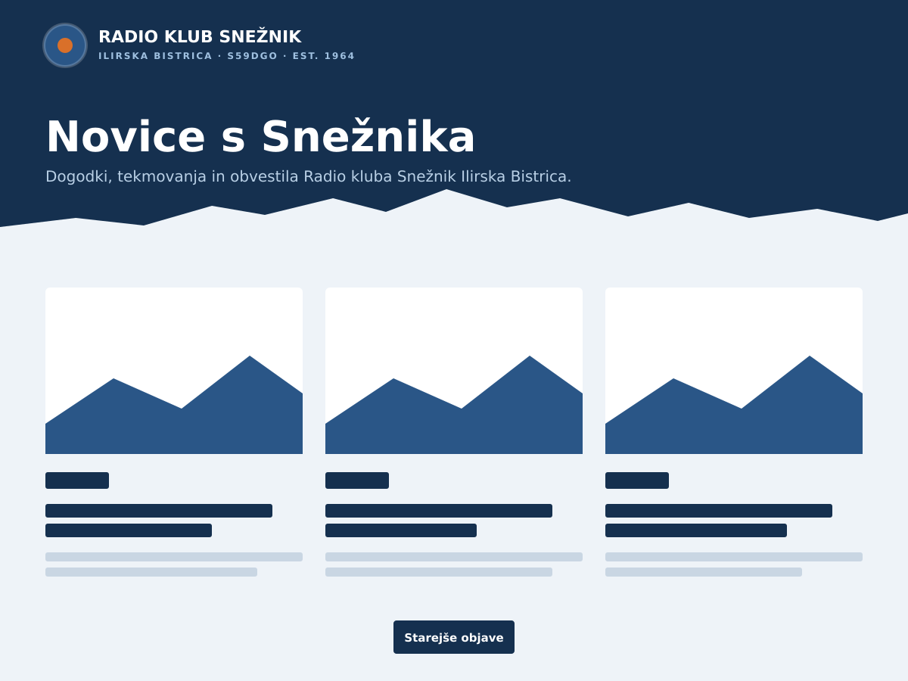

# S59DGO – WordPress tema Radio kluba Snežnik Ilirska Bistrica

Klasična WordPress tema za [www.s59dgo.org](https://www.s59dgo.org/), spletno stran Radio kluba Snežnik Ilirska Bistrica (S59DGO, ustanovljen 1964).

**English summary.** A classic WordPress theme for the website of the Snežnik amateur radio club (S59DGO), Ilirska Bistrica, Slovenia. Dark-navy sticky header with a mountain-ridge band, a responsive grid of post cards, single-column posts and pages, footer widget areas, system-driven dark mode, locally hosted fonts (Space Grotesk, IBM Plex Sans) and no build step. Requires WordPress 6.4+ and PHP 7.4+. Install by uploading `dist/s59dgo.zip` (see Releases) through *Appearance → Themes → Add New → Upload*. Licensed under GPLv2 or later. The UI strings are Slovenian and translation-ready (text domain `s59dgo`).



## Značilnosti

- Temno modra prilepljena glava z logotipom, imenom kluba in menijem (hamburger na mobilnih napravah, podmeniji).
- Trak z grebenom Snežnika, ki nosi naslov strani; na domači strani nastavljiv naslov in podnaslov.
- Mreža objav s slikami, značko kategorije in datumom: 3 stolpci na namizju, 2 na tablici, 1 na telefonu.
- Enostolpne objave in strani z omejeno širino besedila, široke in polne poravnave blokov.
- Noga s tremi območji gradnikov (kontakt, uradne ure, podpora).
- Temni način sledi nastavitvi sistema (`prefers-color-scheme`).
- Pisavi Space Grotesk in IBM Plex Sans gostovani v temi (brez zunanjih klicev, SIL OFL).
- Brez build koraka: čisti CSS s spremenljivkami in nekaj vrstic JavaScripta.

## Zahteve

- WordPress 6.4 ali novejši (preizkušeno na 7.1)
- PHP 7.4 ali novejši

## Namestitev

1. Prenesite `s59dgo.zip` iz zadnje [izdaje](https://github.com/s56oa/WordPressThemeS59DGO/releases) ali ga zgradite z `bin/build-zip.sh`.
2. V administraciji: *Videz → Teme → Dodaj novo → Naloži temo* → izberite zip → Namesti. Teme še ne aktivirajte.
3. *Videz → Meniji*: obstoječi meni dodelite lokaciji **Glavni meni**.
4. *Videz → Prilagodi → Identiteta spletišča*: logotip (okrogel, vsaj 200×200 px) ter po želji **Naslov domače strani** in **Podnaslov domače strani** (prazno = »Novice s Snežnika« in slogan strani).
5. *Videz → Gradniki*: napolnite območja **Noga – Kontakt**, **Noga – Uradne ure** in **Noga – Podpora** (gumb Doniraj kot blok Gumb).
6. *Nastavitve → Branje*: 9 objav na stran (polne vrstice po 3).
7. Preverite s *Predogled v živo*, nato temo aktivirajte.

### Nadgradnja

Zgradite nov zip (pred tem dvignite `Version` v `s59dgo/style.css` in `Stable tag` v `s59dgo/readme.txt`), ga naložite prek *Videz → Teme → Naloži temo* in potrdite **Zamenjaj trenutno z naloženo**. Nastavitve, meni in gradniki se ohranijo.

## Razvoj

Lokalno ni potreben ne PHP ne WordPress; orodja tečejo v Dockerju.

```bash
bin/lint.sh          # sintaksa JS (node --check) in PHP (php -l v php:8.3-cli)
bin/test.sh          # statični in enotski testi v tests/ (stubi WP funkcij v tests/stubs.php)
bin/phpcs.sh         # PHP_CodeSniffer z WordPress Coding Standards; --fix požene phpcbf
bin/screenshot.sh    # regenerira s59dgo/screenshot.png iz bin/screenshot.svg
bin/build-zip.sh     # lint + testi + phpcs + dist/s59dgo.zip
```

Struktura:

```
s59dgo/                 tema (slug, text domain in prefiks funkcij: s59dgo)
├── style.css           glava teme, @font-face in vsi slogi (CSS spremenljivke --barva-*)
├── theme.json          samo settings (paleta, pisave, velikosti, širine)
├── functions.php       nalaga inc/setup.php, enqueue.php, template-tags.php, customizer.php
├── header.php          glava; na koncu vključi template-parts/trak.php
├── home.php, index.php, archive.php, search.php   → template-parts/mreza.php (mreža objav)
├── single.php, page.php, 404.php, comments.php, searchform.php, footer.php
├── template-parts/     trak, kartica, mreza, vsebina-objava, vsebina-stran
└── assets/             fonts/ (woff2 + licenci), js/navigation.js, css/editor.css, img/greben.svg
docs/superpowers/       spec dizajna in načrt implementacije
tests/                  testi, ki tečejo brez WordPressa
```

Razvijalske prilagoditvene točke: filtri `s59dgo_naslov_doma`, `s59dgo_podnaslov_doma` in `s59dgo_noga_besedilo`.

Dizajn (smer »Grebeni«) je nastal s Claude Design; koda je bila napisana s pomočjo Claude Code, z avtomatskimi pregledi kode in varnostnim pregledom.

## Licenca

GPLv2 ali novejša (glej `LICENSE`). Pisavi Space Grotesk (Florian Karsten) in IBM Plex Sans (IBM) sta pod SIL Open Font License 1.1; licenci sta v `s59dgo/assets/fonts/`.

---

Radio klub Snežnik Ilirska Bistrica · S59DGO · [www.s59dgo.org](https://www.s59dgo.org/)
